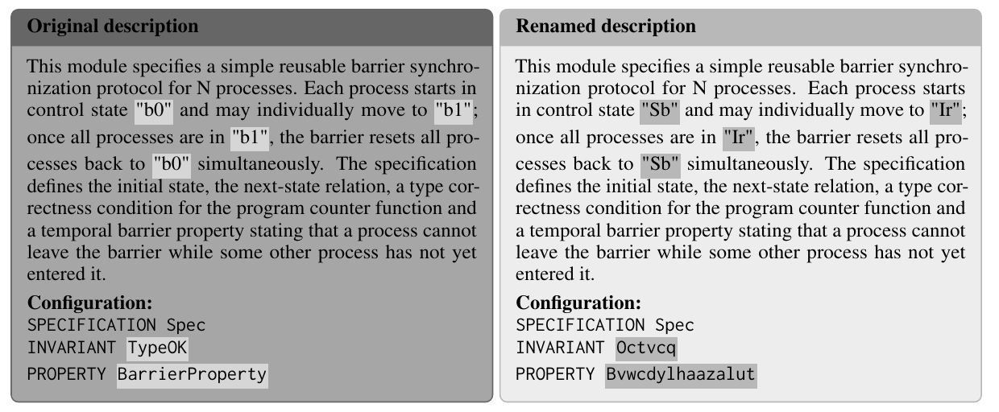

ALIAS: Evaluating Performance and Memorization in LLM-Written TLA+ Specifications
=================================================================================

:Status: Preprint
:Date: October 2026
:Authors: Arslan Bisharat, Mujtaba Nazari, Khushboo Bhadauria, Brian Ortiz, Eric Spencer, Beatriz Santos, TaiNing Wang, George K. Thiruvathukal, Konstantin Läufer, Mohammed Abuhamad
:Institution: Loyola University Chicago
:Paper: `arXiv:2610.29767 <https://arxiv.org/abs/2610.29767>`__ | `PDF <https://arxiv.org/pdf/2610.29767>`__
:DOI: `10.48550/arXiv.2610.29767 <https://doi.org/10.48550/arXiv.2610.29767>`__
:Artifact: `Code and data <https://github.com/LUC-AI4FM/ALIAS>`__

   **Figure 1.** The Barrier task as the model receives it, with the configuration that checks the output. Renamed parts are shaded, and the description states neither required name. From the paper, reproduced under CC BY 4.0.

Abstract
--------

Memorization inflates the benchmark scores of large language models, since a model can
reproduce answers it saw in training. Researchers test for it with consistent identifier
renaming (CIR), which gives every identifier in a task a new name, and treat a lower score
on the renamed task as evidence of recall. We test this method on the Temporal Logic of
Actions Plus (TLA+) language, whose model checker acts as an oracle by confirming whether
a renamed task keeps the exact behaviors of the original. Across 111 TLA+-Bench tasks,
renaming lowers the correctness of Claude Opus 4.8 from 28% to 18% and of GPT-5 from 9% to
7%. Most of this decrease comes from how the test grades, which requires exact names that
most descriptions never state. Grading by behavior shrinks the decrease to about 3 points
for Opus 4.8 and to 0 for GPT-5. In two model families fine-tuned on disjoint halves of the
tasks, renaming removes about half of the training gain in likelihood and costs 4.9 points
(Qwen) and 1.3 points (Gemma) on unseen tasks. A lower score after renaming therefore mixes
memorization, name-based grading and the cost of new names.

Key Results
-----------

.. list-table::
   :header-rows: 1

   * - Measure
     - Claude Opus 4.8
     - GPT-5
   * - Correct on original descriptions, all 111 tasks
     - 28.3%
     - 9.2%
   * - Correct on renamed descriptions, all 111 tasks
     - 18.2%
     - 7.0%
   * - Drop after renaming, exact-name grading (90 tasks)
     - 10.4 points
     - 2.4 points
   * - Drop after renaming, behavior grading (90 tasks)
     - **3.1 points**
     - **0.0 points**

.. raw:: html
   :file: _figures/alias-drop.html

For the two fine-tuned models, renaming costs 4.9 points (Qwen2.5-Coder-14B) and 1.3 points
(Gemma 4 31B) on tasks the model never saw, under behavior-based grading.

The abstract, Figure 1 and the numbers on this page come from the paper, which is released
under a CC BY 4.0 license. The code, renamed tasks, and all model outputs are in the
`ALIAS repository <https://github.com/LUC-AI4FM/ALIAS>`__.

Why This Matters
----------------

Benchmarks are only useful if a good score reflects skill and not recall of the answer.
Renaming is a cheap and popular check, but this paper shows that its result is easy to
misread. The paper also gives recommendations for contamination tests and for people who
build benchmarks, so that memorization claims about LLMs are more reliable.

In Plain Words
--------------

AI models learn from huge amounts of text, and some of that text may include the very
problems used to test them. When that happens, a model can score well because it has
seen the answer before, not because it can solve the problem. This is called
memorization, and it makes a test score look better than it should.

A popular way to check for memorization is to rename things. In a TLA+ task, you change
the names of the variables and other identifiers everywhere, but keep the meaning exactly
the same. If the model only remembered the old answer, the new names should throw it off,
and its score should drop. Researchers call this consistent identifier renaming.

This paper asks whether that test is as clear as it seems. The team used 111 tasks from
TLA+-Bench. Because TLA+ has a model checker, they could confirm that a renamed task still
behaves exactly like the original. That is hard to do with ordinary code, and it is one
reason TLA+ is a good place to study the question.

Renaming did lower the scores. Claude Opus 4.8 went from 28% correct to 18%, and GPT-5
went from 9% to 7%. But look at how the answers were graded. The benchmark checks an
answer against a configuration file that names specific parts, such as an invariant
called TypeOK. If the task description never mentions that name, even a correct answer
fails. In the example in Figure 1, the description states neither name that the checker
needs. When the team graded by behavior instead, so that names did not matter, the drop
shrank to about 3 points for Opus 4.8 and to 0 for GPT-5.

The team also trained two models, Qwen and Gemma, on one half of the tasks each, so they
knew exactly which tasks each model had seen. Renaming took away about half of what the
training had gained, measured by how likely the model found the correct text. It also
lowered accuracy on tasks the model had never seen: by 4.9 points for Qwen and 1.3 for
Gemma. That means renaming can hurt a model even when memory plays no part.

The takeaway is that a lower score after renaming is not proof of memorization. It mixes
three things: memorization, grading that depends on names, and the extra difficulty of
unfamiliar names. To understand what a model really knows, those three need to be pulled
apart.

Citation
--------

Arslan Bisharat, Mujtaba Nazari, Khushboo Bhadauria, Brian Ortiz, Eric Spencer,
Beatriz Santos, TaiNing Wang, George K. Thiruvathukal, Konstantin Läufer, and
Mohammed Abuhamad. *ALIAS: Evaluating Performance and Memorization in LLM-Written
TLA+ Specifications*. arXiv:2610.29767, 2026. https://doi.org/10.48550/arXiv.2610.29767

BibTeX
------

.. code-block:: bibtex

   @misc{bisharat2026alias,
     title         = {{ALIAS}: Evaluating Performance and Memorization in {LLM}-Written {TLA+} Specifications},
     author        = {Bisharat, Arslan and Nazari, Mujtaba and Bhadauria, Khushboo and Ortiz, Brian and Spencer, Eric and Santos, Beatriz and Wang, TaiNing and Thiruvathukal, George K. and Läufer, Konstantin and Abuhamad, Mohammed},
     year          = {2026},
     eprint        = {2610.29767},
     archivePrefix = {arXiv},
     doi           = {10.48550/arXiv.2610.29767},
     url           = {https://arxiv.org/abs/2610.29767}
   }
