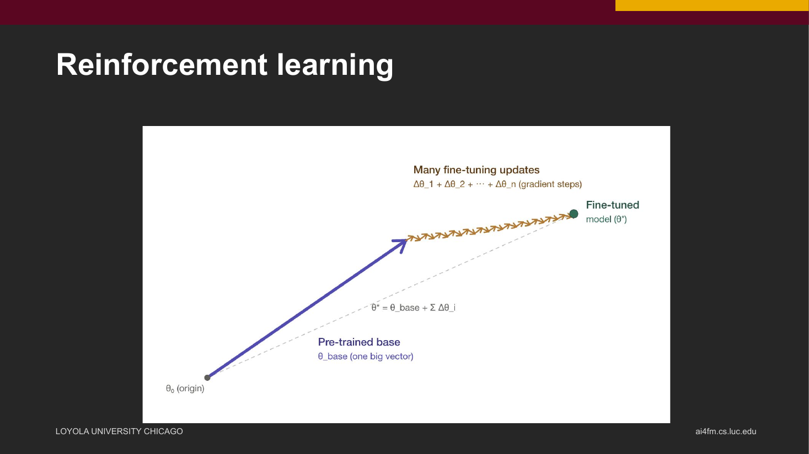

ChatTLA+: Using LLMs for TLA+ Formal Specification Generation and Verification
===============================================================================

:Status: Presented
:Venue: Undergraduate Research and Engagement Symposium, Loyola University Chicago, April 17, 2026
:Authors: Eric Spencer
:Institution: Loyola University Chicago
:Archive / PDF: `Loyola eCommons archival record <https://ecommons.luc.edu/ures/2026uresarchive/2026uresarchive/41/>`__ | `View archival PDF <https://ecommons.luc.edu/cgi/viewcontent.cgi?article=2648&context=ures>`__

   **Figure 1.** A slide from the talk, on how reinforcement learning fine-tunes a pre-trained model through many small updates.

Abstract
--------

A presentation exploring the use of large language models for generating and verifying
TLA+ formal specifications. The talk examines how LLMs can assist in the synthesis of
formal specifications from natural language, discussing both the promise and the
limitations of current models on rigorous specification tasks.

This work builds on the group's systematic evaluation of LLMs on TLA+ specification
synthesis, extending the discussion to practical generation and verification pipelines.

Based On
--------

This presentation builds on the :doc:`published ICSOFT 2026 paper
<../papers/llm-tla-evaluation>`. The archival record uses the title *ChatTLA+ - Can
LLMs Write Correct TLA+ Specifications?*.

Presentation
------------

:download:`View the presentation (PDF) </_static/ChatTLA-presentation-2026.pdf>`

In Plain Words
--------------

This talk was given by Eric Spencer at the Undergraduate Research and Engagement Symposium at Loyola in April 2026. It is about using large language models, the AI systems behind chatbots, to write and check TLA+ specifications.

TLA+ is a language for describing how a system should behave, and a model checker is a tool that tests whether the description holds up. Many important systems depend on rules like these, but writing them takes training. The attraction of using an AI model is easy to see: a person describes the system in ordinary language, and the model drafts the formal version.

The talk looks at both sides of that idea. On the promising side, a model could produce a first draft, which would save time for people who are learning TLA+. On the other side, a formal specification has to be exactly right, and AI models are good at producing text that looks right but is not. The group's earlier study measured this gap. Models could produce text in the right form up to 26.6% of the time, but only 8.6% of the outputs passed the model checker.

That is why the talk stresses verification as well as generation. Writing a specification is only half the job. The other half is checking it with a tool.

The talk builds on the group's published ICSOFT 2026 paper, and it extends the discussion to practical pipelines that generate a specification and then verify it. The slides are available to download on this page. The archival record lists the same work under the title "ChatTLA+ - Can LLMs Write Correct TLA+ Specifications?", which is how you will find it in the Loyola eCommons.

Citation
--------

Eric Spencer,
*ChatTLA+: Using LLMs for TLA+ Formal Specification Generation and Verification*,
Undergraduate Research and Engagement Symposium, Loyola University Chicago, April 17, 2026.

BibTeX
------

.. code-block:: bibtex

   @misc{spencer2026chattla,
     title        = {{ChatTLA+}: Using {LLMs} for {TLA+} Formal Specification Generation and Verification},
     author       = {Spencer, Eric},
     year         = {2026},
     month        = apr,
     howpublished = {Presentation, Undergraduate Research and Engagement Symposium (URES), Loyola University Chicago},
     url          = {https://ecommons.luc.edu/ures/2026uresarchive/2026uresarchive/41/}
   }
